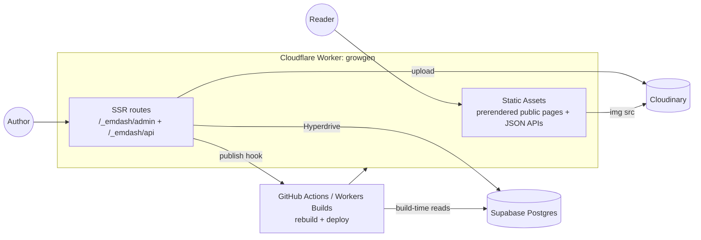
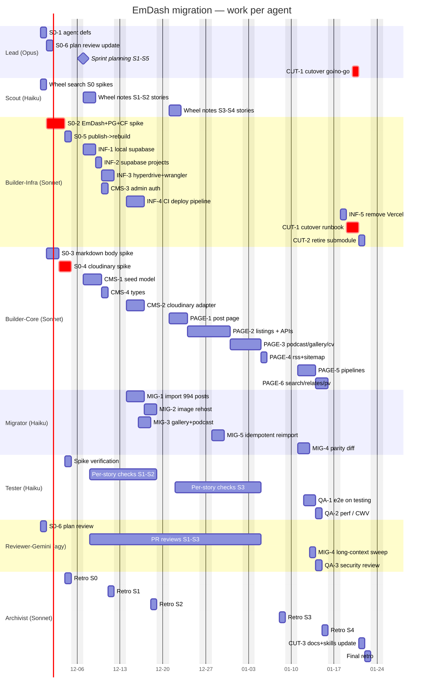

# EmDash Migration Plan

> Status: **DRAFT, waiting for owner approval**. No implementation has started.
> Branch: `feat/emdash-migration-plan` · Drafted 2026-11-24 · Owner: site maintainer · Orchestrator: Claude Opus 5.5

Goal: move growgen.xyz from "Astro + markdown git submodule + Vercel" to:

| Concern | Today | Target |
|---|---|---|
| CMS / content source | `src/content` git submodule (994 `.md` posts, `_gallery`) | **EmDash 1.x** (Astro integration, admin UI at `/_emdash/admin`) |
| Database | none (files) | **Supabase Postgres**, 3 environments: `local`, `testing`, `public` |
| Hosting | Vercel (`vercel.json`), partial Cloudflare (`wrangler.json`, `sync-content.yml`) | **Cloudflare Workers + Static Assets**: public pages prerendered, admin/API on the Worker |
| Images | Cloudinary URLs in posts + `optimizeCloudinaryUrl` (`packages/utils/cloudinary.ts`) | **Cloudinary** for everything, including new EmDash media uploads |

Principle: **don't reinvent the wheel.** Every story starts by checking for an existing EmDash feature, a first-party `@emdash-cms/*` package, a plugin in the registry (https://plugins.emdashcms.com), or an npm/Astro integration. We only write code to glue things together.

---

## 1. What the site does today (feature inventory)

This inventory is also the regression checklist. Every row must still work after the migration (story `MIG-*` / `PAGE-*` / `QA-*`).

### 1.1 Content and routing
| # | Feature | Where |
|---|---|---|
| F1 | Blog posts with frontmatter `type, category, adsense, tag[], series{slug,name,number}, cover{url,alt}, city[]` | `src/content.config.ts`, `src/content/_docs/YYYY/MM/DD/*.md` (994 files) |
| F2 | Post URL `/[category]/[year]/[month]/[day]/[slug]` | `src/pages/[category]/.../[slug].astro` |
| F3 | Category, tag, series, year, and city listing pages | `[filter].astro`, `tag/`, `tags.astro`, `series/`, `year/`, `world/[city].astro` |
| F4 | Paginated NDJSON/JSON APIs for client islands (cards, category, tag, series, year, world, podcast, relates, heatmap, umap, peak) | `src/pages/api/**` |
| F5 | Podcast list and episode pages, fetched from a feed | `podcast.astro`, `podcast/[id].astro`, `packages/fetch-podcast` |
| F6 | Gallery with SVG traces and depth estimation | `_gallery`, `packages/prepare-gallery`, `packages/depth-estimation` (Python), `api/gallery/trace` |
| F7 | Resume / CV pages per role and language, plus PDF generation at build time | `resume/[role]/[lang].astro`, `packages/resume/generate-pdfs.mjs` |
| F8 | Static pages: about, contact, privacy, lab, gemini, hero-gallery, sitemap treemap, 404 | `src/pages/*.astro` |
| F9 | RSS feed and XML sitemap with exclusions | `rss.xml.ts`, `@astrojs/sitemap` in `astro.config.mjs` |

### 1.2 Markdown rendering
| # | Feature | Where |
|---|---|---|
| F10 | KaTeX math, `remark-attributes`, external-link rehype, Cloudinary rehype | `astro.config.mjs` unified pipeline |
| F11 | Shiki with every bundled language, plus PlantUML grammar; Mermaid diagrams | `shiki-plantuml`, `astro-mermaid` |
| F12 | MDX components such as `DescriptionImage` (no `.mdx` posts today, but the pipeline supports them) | `packages/image` |

### 1.3 Generated data pipelines
| # | Feature | Where |
|---|---|---|
| F13 | Post metadata, covers, colours, `isShort` | `packages/content-prepare`, `packages/image-metadata` |
| F14 | Embeddings (Python) and UMAP (Rust), used by related posts, `/umap`, and the particle hero | `packages/embedding`, `metadata-embedding`, `post-embedding`, `umap`, `rag-umap` |
| F15 | Generated artifacts committed in `src/content/generated/` | `packages/consts/config.js` |

### 1.4 UI and interactivity
| # | Feature | Where |
|---|---|---|
| F16 | Mantine / MUI / shadcn React islands, nanostores state | `src/stores`, `packages/*` |
| F17 | Client search (minisearch + Mantine Spotlight) | `packages/search`, `src/stores/search.ts` |
| F18 | Related posts, carousel, masonry, bento, folders, heatmap, world map (maplibre) | `packages/{carousel,masonry,heat,map,folder}` |
| F19 | WebGL backgrounds, particle hero, Rapier physics | `src/bits`, `packages/particle-hero` |
| F20 | View transitions, prefetch on hover, skeletons | `TransitionFrom.astro`, `stores/skeletons.ts` |
| F21 | View count display (worker removed; fetches `PV_URL`) | `src/stores/pv.ts` |
| F22 | Newsletter and follow widgets | `NewsLetter.tsx`, `packages/follow` |

### 1.5 Business and operations
| # | Feature | Where |
|---|---|---|
| F23 | Mixpanel with opt-in consent | `packages/analytics` |
| F24 | Google AdSense (per-post `adsense` flag) | `packages/ads` |
| F25 | Vitest unit tests; Cucumber + Playwright e2e (`@smoke`, `@analytics-on/off`) | `vitest.config.ts`, `e2e/` |
| F26 | GitHub Actions: e2e, content submodule sync | `.github/workflows/` |

---

## 2. Target architecture

### 2.1 Key decisions (each validated by a Sprint 0 spike)

| ID | Decision | Existing wheel we reuse | Risk / fallback |
|---|---|---|---|
| D1 | Add EmDash to **this** Astro app (`emdash` integration). Don't start from `npm create emdash`. | `emdash`, `@emdash-cms/cloudflare` | Our islands, pipelines and tests stay as they are. Use the starter template only as a reference. |
| D2 | Adapter `@astrojs/cloudflare`, `output: "server"`. Every public page sets `export const prerender = true` and reads EmDash at build time. Only `/_emdash/*` stays SSR. This gives a static site with a CMS on the same Worker. | Astro prerender, Workers Static Assets | If EmDash can't query at build time from Node against Postgres, fall back to SSR plus `cacheCloudflare()` route caching. EmDash already purges cache tags on publish. |
| D3 | Database is **Supabase Postgres**. On Workers, connect through `hyperdrive({ binding: "HYPERDRIVE" })` with caching disabled on the primary binding. For Node CLI, migrations and build, use `postgres({ connectionString: DATABASE_URL })`. Use Supabase's **direct or session-pooler** connection string, not the transaction pooler, because EmDash migrations need a role that owns the tables. | `emdash/db` postgres dialect, Hyperdrive, Supabase CLI | EmDash docs don't name Supabase, but it's standard Postgres. Postgres also means no built-in FTS and no **sandboxed** registry plugins (D1-only on Hyperdrive). We keep our own minisearch (F17) and use only npm-installed native plugins. |
| D4 | Three environments are mapped 1:1: `local`: `supabase start` (Docker) with `astro dev` `testing`: Supabase project `growgen-testing` with `wrangler --env testing` on a `*.workers.dev` / `testing.growgen.xyz` URL `public`: Supabase project `growgen-public` with the production Worker on `growgen.xyz` | Supabase CLI (`supabase start/link/db dump`), wrangler `env.*`, `npx emdash migrate` | Secrets live in `.dev.vars` / wrangler secrets / GitHub environment secrets. Nothing goes in `astro.config`. |
| D5 | Post body stays **Markdown** in a long-text field, rendered at build time by our existing unified pipeline. This keeps KaTeX, Mermaid, PlantUML and remark-attributes working with no loss. | Our existing `astro.config.mjs` pipeline; a markdown field from `@emdash-cms/plugin-field-kit` if it has one | The alternative, Portable Text, would need custom blocks for math, diagrams and attributes for 994 posts. We can revisit it later (backlog `BL-PT`). |
| D6 | Media goes to Cloudinary. The order of preference is (1) an existing EmDash Cloudinary storage adapter or media provider from the registry or npm, (2) a thin storage adapter implementing EmDash's `Storage` interface (`upload/download/delete/exists/list/getPublicUrl/getSignedUploadUrl`) over Cloudinary's REST Upload API with signed `fetch`. The Node SDK doesn't run on Workers. Existing post images already on Cloudinary are left untouched. Douban and other hot-linked images get re-hosted to Cloudinary. | Cloudinary Upload API, existing `optimizeCloudinaryUrl` | If adapter work stalls: `s3()` adapter to R2 plus a Cloudinary **auto-upload mapping** of that bucket. Cloudinary still serves every image, and we write no code. |
| D7 | Taxonomies: `category`, `tag`, `series`, `city` become EmDash taxonomies. Series order (`number`) is a field on the post. | EmDash taxonomies + `npx emdash taxonomy` | — |
| D8 | Keep the Astro-side integrations we already have: `@astrojs/rss`, `@astrojs/sitemap`, Mixpanel, AdSense. Add the first-party EmDash **SEO** plugin for per-post meta only if it doesn't fight `BaseHead.astro`. | already installed | — |
| D9 | Republish trigger: EmDash publish fires a webhook, which triggers a GitHub Actions `repository_dispatch` that builds and runs `wrangler deploy`. We reuse the pattern already in `sync-content.yml`. A webhook plugin is preferred; otherwise use a small native plugin hook (`content:afterPublish`). | existing `sync-content.yml` pattern, Workers Builds deploy hook | Nightly cron rebuild as a safety net, as today. |
| D10 | Generated pipelines (F13–F15) read from EmDash (CLI `content list --json` / DB) instead of the submodule and write the same JSON. Readers in `packages/utils` don't change. | `npx emdash content list --json`, existing pipelines | Phase 2 option: store embeddings in Supabase `pgvector` (backlog `BL-VEC`). |

---

## 3. Agents and their jobs

All agents work from this plan, pick stories from the backlog, and update the Gantt chart (§6) when they start or finish a story. Agent definitions are created in Sprint 0 as `.claude/agents/*.md`. Gemini calls go through the `cc-suite:agy` skill.

| Agent | Model | Role | Owns | Never does |
|---|---|---|---|---|
| **Lead** (orchestrator) | Claude Opus 5.5 (this session) | Architect, product owner proxy, sprint planner, final reviewer | Sprint planning, decision log (§2.1), splitting stories, merge gating, conflicts between agents, talking to you | Bulk mechanical edits |
| **Scout** | Haiku | Wheel-finder. Before every story, searches EmDash docs, the plugin registry, npm and Astro integrations, then writes a short "use X / nothing exists" note into the story | `docs/plan/emdash/scout/*.md` | Writing production code |
| **Builder-Core** | Sonnet | App work: EmDash integration, collections and seed, Astro page and API rewiring, Cloudinary adapter | `src/**`, `packages/{utils,consts,emdash-*}` | Infra secrets |
| **Builder-Infra** | Sonnet | Platform work: Supabase projects and CLI, Hyperdrive, wrangler envs, `@astrojs/cloudflare` adapter, GitHub Actions, DNS cutover runbook | `wrangler.json(c)`, `supabase/`, `.github/workflows/`, `docs/plan/emdash/runbooks/` | Page code |
| **Migrator** | Haiku | High-volume, mechanical work: frontmatter-to-seed mapping, import runs, link and image rehost reports, diffs between old and new HTML for 994 posts | `packages/emdash-import/`, migration reports | Design decisions; it escalates anomalies to Lead |
| **Tester** | Haiku | Runs `pnpm test`, `pnpm test:e2e`, `emdash doctor`, `emdash migrate --check` for each story and summarizes failures | test reports in PR comments | Fixing code; it hands failures back to the owning builder |
| **Reviewer-Gemini** | Gemini via `cc-suite:agy` | Independent second opinion. Reviews every story PR for correctness and security, reviews this plan, and does long-context sweeps (for example, comparing old and new rendered HTML for all posts) | review notes on PRs | Approving its own suggestions |
| **Archivist** (retrospective keeper) | Sonnet | Saves retrospective knowledge. After every story it adds a "what we learned" entry; at each sprint end it runs the retrospective (keep / problem / try), updates `docs/plan/emdash/retro/sprint-N.md` and the running `docs/plan/emdash/knowledge.md` (gotchas, verified commands, rejected options and why), and saves durable lessons to Claude memory | `docs/plan/emdash/retro/`, `knowledge.md`, memory files | Changing code |

**How a story flows:** Lead picks it → Scout checks for existing wheels → Builder implements on `emdash/<story-id>` → Tester runs checks → Reviewer-Gemini reviews → Lead merges into `feat/emdash` → Archivist records lessons → Gantt status set to `done`.

Haiku and Sonnet builders run as Claude Code subagents (`Agent` tool with `model`). Parallel builders use `isolation: "worktree"` so their branches don't collide.

---

## 4. Backlog (epics → user stories)

Estimates are story points (1 = a few hours, 8 = several days). DoD = Definition of Done.

**Global Definition of Done:** `pnpm build` passes · unit tests green · e2e `@smoke` green on `testing` · Reviewer-Gemini notes resolved · Gantt updated · Archivist entry written.

### EPIC E0: Foundation and spikes
| ID | Story | Agent | Pts |
|---|---|---|---|
| S0-1 | As Lead, I have agent definitions (`.claude/agents/{scout,builder-core,builder-infra,migrator,tester,archivist}.md`) and an agy review prompt, so the team can start | Lead | 2 |
| S0-2 | **Spike:** EmDash + Postgres (Supabase local) + `@astrojs/cloudflare`; prove that `prerender = true` pages can call `getEmDashCollection` at build time (D2) | Builder-Infra | 5 |
| S0-3 | **Spike:** Markdown body field (D5). Is there a markdown field in Field Kit or core? Render one KaTeX + Mermaid + PlantUML post | Builder-Core | 3 |
| S0-4 | **Spike:** Cloudinary media in EmDash (D6). Scout searches registry and npm; build a 1-file adapter prototype or confirm the R2 + auto-upload fallback | Scout → Builder-Core | 5 |
| S0-5 | **Spike:** publish → rebuild trigger (D9) | Builder-Infra | 2 |
| S0-6 | Reviewer-Gemini reviews this plan; Lead updates decisions | Reviewer-Gemini, Lead | 1 |

### EPIC E1: Environments and infrastructure
| ID | Story | Agent | Pts |
|---|---|---|---|
| INF-1 | As a developer, `pnpm db:start` runs Supabase locally and `pnpm dev` connects to it (`local`) | Builder-Infra | 3 |
| INF-2 | Supabase projects `growgen-testing` and `growgen-public` exist, each with an EmDash-owner role, and connection strings are stored as GitHub environment secrets | Builder-Infra | 2 |
| INF-3 | Hyperdrive configs per env and `wrangler.jsonc` with `env.testing` and production (nodejs_compat, assets, HYPERDRIVE binding) | Builder-Infra | 3 |
| INF-4 | CI: on PR, deploy to `testing` and run e2e smoke; on `master`, deploy to `public`. `npx emdash migrate` runs before deploy, `--check` on PR | Builder-Infra | 5 |
| INF-5 | Remove Vercel (`vercel.json`, `VERCEL_GIT_COMMIT_SHA` → `CF_PAGES_COMMIT_SHA`/`GITHUB_SHA`) | Builder-Infra | 1 |

### EPIC E2: CMS model and media
| ID | Story | Agent | Pts |
|---|---|---|---|
| CMS-1 | Seed file `seed/seed.json` defines `posts` (title, slug, date, type/status, category, adsense, cover, body markdown, series ref + number, city) plus `podcasts`, `gallery`, `pages` collections, and taxonomies (D7) | Builder-Core | 5 |
| CMS-2 | Cloudinary storage adapter or provider wired in, from the S0-4 result (D6) | Builder-Core | 5 |
| CMS-3 | Passkey admin login works on `testing`; author role created | Builder-Infra | 2 |
| CMS-4 | `npx emdash types` generates types consumed by `packages/utils` | Builder-Core | 1 |

### EPIC E3: Content migration
| ID | Story | Agent | Pts |
|---|---|---|---|
| MIG-1 | Import script `packages/emdash-import` maps the 994 md files and their frontmatter into EmDash. It uses EmDash's own `seed`/`content create` CLI or API; no custom DB writes | Migrator | 5 |
| MIG-2 | Image rehost: non-Cloudinary images (Douban and others) are uploaded to Cloudinary and their URLs rewritten. Report for broken links | Migrator | 3 |
| MIG-3 | Gallery (`_gallery`) and podcast data imported; `fetch-podcast` writes to EmDash | Migrator, Builder-Core | 3 |
| MIG-4 | Parity check: old and new rendered HTML compared for all posts; Reviewer-Gemini does a long-context sweep of the diffs | Migrator, Reviewer-Gemini | 3 |
| MIG-5 | Idempotent re-import (`--on-conflict update`) so the content freeze can be short | Migrator | 2 |

### EPIC E4: Site rewiring
| ID | Story | Agent | Pts |
|---|---|---|---|
| PAGE-1 | Post page and its URL scheme come from EmDash (F2), with the same URLs | Builder-Core | 5 |
| PAGE-2 | Listing pages and NDJSON APIs (F3, F4) come from EmDash; `packages/utils` readers are swapped behind the same function signatures | Builder-Core | 8 |
| PAGE-3 | Podcast, gallery, resume, and static pages (F5–F8) | Builder-Core | 5 |
| PAGE-4 | RSS and sitemap read EmDash (F9) | Builder-Core | 1 |
| PAGE-5 | Generated pipelines (F13–F15) read EmDash instead of the submodule (D10) | Builder-Core | 5 |
| PAGE-6 | Search index, related posts, view count, and analytics behave the same (F17, F18, F21, F23) | Builder-Core | 3 |

### EPIC E5: Quality, cutover, cleanup
| ID | Story | Agent | Pts |
|---|---|---|---|
| QA-1 | e2e suite runs against `testing`; new e2e checks for admin login and the publish → rebuild path | Tester | 3 |
| QA-2 | Lighthouse and CWV are no worse than the current Vercel build | Tester | 2 |
| QA-3 | Security review: secrets, admin route exposure, Supabase RLS / role grants | Reviewer-Gemini | 2 |
| CUT-1 | Cutover runbook: content freeze → final MIG-5 → DNS to Cloudflare → smoke test → rollback plan (Vercel kept warm for 7 days) | Builder-Infra, Lead | 2 |
| CUT-2 | Retire the `src/content` submodule and `sync-content.yml`; archive the content repo read-only | Builder-Infra | 1 |
| CUT-3 | Update `CLAUDE.md`, `AGENTS.md`, and skills (new `emdash` skill) | Archivist | 2 |

### Icebox (not committed)
- `BL-PT`: convert Markdown bodies to Portable Text for a rich editor.
- `BL-VEC`: store embeddings in Supabase `pgvector` and compute related posts in the database.
- `BL-COMMENTS`: enable EmDash core comments.
- `BL-I18N`: EmDash i18n for the resume and posts.
- `BL-SEARCH`: Cloudflare AI Search plugin. Blocked on Postgres; would need D1.

---

## 5. Sprints (1-week sprints; Sprint 0 starts after approval, tentatively 2026-11-30)

| Sprint | Dates | Goal | Stories | Pts |
|---|---|---|---|---|
| S0 | 11-30 → 12-04 | Prove the risky decisions, set up the agent team | S0-1…S0-6 | 18 |
| S1 | 12-07 → 12-11 | Three environments live, CMS model seeded | INF-1…INF-3, CMS-1, CMS-3, CMS-4 | 16 |
| S2 | 12-14 → 12-18 | Content in EmDash, images on Cloudinary, CI deploys | CMS-2, MIG-1, MIG-2, MIG-3, INF-4 | 21 |
| S3 | 12-21 → 01-08 (holiday-stretched) | Site reads EmDash end to end | PAGE-1…PAGE-4, MIG-5 | 21 |
| S4 | 01-11 → 01-15 | Pipelines, parity, quality | PAGE-5, PAGE-6, MIG-4, QA-1…QA-3 | 18 |
| S5 | 01-18 → 01-22 | Cutover and cleanup | INF-5, CUT-1…CUT-3 | 6 |

Ceremonies, run by agents:
- **Planning** (Lead): start of each sprint. Pull stories, confirm Scout notes exist.
- **Daily** (Lead): read the Gantt, unblock, reassign.
- **Review**: you get a demo on the `testing` URL at the end of each sprint.
- **Retrospective** (Archivist): `retro/sprint-N.md` plus a `knowledge.md` update.

---

## 6. Gantt chart: work per agent

Each section is one agent. Agents mark a task `active` when they start and `done` when they finish, and Lead adds `crit` to anything that's blocking. The chart renders on GitHub and in the site's Mermaid setup.

---

## 7. Top risks

| Risk | Impact | Mitigation |
|---|---|---|
| EmDash on Postgres is less exercised than D1 (no FTS, no sandboxed plugins) | Missing features | We already have our own search. Use native npm plugins only. The S0-2 spike decides whether we continue. |
| Prerendering against EmDash at build time is not a documented path | No static site | Fall back to SSR with Cloudflare route caching. Readers still get cached HTML. |
| No Cloudinary adapter exists | Extra code | Thin adapter (about 150 lines, Upload REST API) or the R2 + auto-upload fallback. |
| 994-post parity: KaTeX, Mermaid, PlantUML, remark-attributes | Broken posts | Markdown body (D5) plus the MIG-4 HTML diff. |
| Supabase pooler incompatibility with migrations | Migration failures | Direct or session connection string for migrations; Hyperdrive for runtime. |
| Long Worker build (Shiki with all languages, PDFs, WebGL) | CI time | Build in GitHub Actions and `wrangler deploy` the output; don't use Workers Builds limits. |

---

## 8. Open questions for the owner
1. Is it OK to deploy Worker SSR only for `/_emdash/*` (admin) while every public page is prerendered static? That's my reading of "static site on Cloudflare".
2. Is a Markdown body (D5) OK for now, or do you want the rich Portable Text editor from day one?
3. Do you have Supabase and Cloudflare Workers **Paid** accounts? Paid is needed for Hyperdrive at production scale and for any sandboxed plugin later.
4. Sprint length: 1 week as planned, or 2 weeks?

## Sources
- EmDash docs: database, storage, Cloudflare deployment, CLI, plugins, route caching (docs.emdashcms.com)
- Cloudflare blog, "EmDash 1.0: the stable CMS with a secure plugin registry" (2026-09-28)
- Astro docs, "EmDash & Astro"
