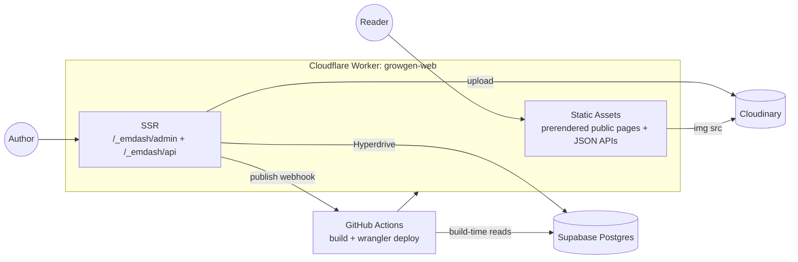
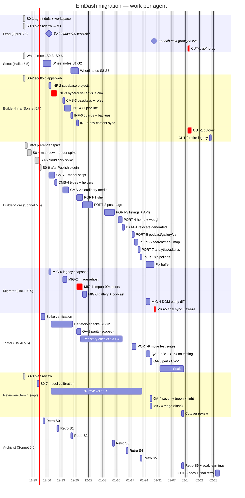

# EmDash Migration Plan

> Status: **v3, approved and in progress** (Sprint 0). Integration branch: `feat/emdash` · Updated 2026-11-24 · Orchestrator: Claude Opus 5.5
>
> v3 changes: the S0-2 scaffold results, the Scout notes (S0-3…S0-6) and the Gemini plan review (S0-8, 15 findings; dispositions in §11) are folded in. Key shifts: free-tier limits corrected (Workers 64 MiB; Supabase IPv4 only via the pooler), Markdown rendered with `createMarkdownProcessor()`, R2 dropped, security and passkey handling (D11), data relocation (DATA-1), and the sprints resequenced.
>
> v2 changes after owner feedback: we build a **fresh EmDash site** (`npm create emdash`) as one workspace package, `apps/web`. It goes live on a **new domain** first and moves to growgen.xyz once stable. **All three environments use Supabase**, local included. The agy (Gemini) models are confirmed from `agy models`.

## 0. Summary

| Concern | Today (legacy site) | Target (new site) |
|---|---|---|
| Codebase | Astro app in repo root `src/` | **Fresh scaffold** from `npm create emdash@latest` (cloudflare template) in **`apps/web`**, a single workspace package |
| CMS / content source | `src/content` git submodule (994 `.md` posts, `_gallery`) | **EmDash 1.x** admin at `/_emdash/admin` |
| Database | none (files) | **Supabase Postgres** in all 3 envs: `local` (`supabase start`), `testing`, `production` |
| Hosting | Vercel (`vercel.json`) | **Cloudflare Worker + Static Assets**: public pages prerendered, admin/API served by the Worker |
| Images | Cloudinary URLs in posts plus Douban and other hot-links | **Cloudinary** for all images, including new uploads |
| Domain | growgen.xyz | New domain (proposed `next.growgen.xyz`) until stable, then **cut over to growgen.xyz** |
| URL paths | `/[category]/[yyyy]/[mm]/[dd]/[slug]` etc. | **Identical paths.** A CI test enforces it. |

**Rule: don't reinvent the wheel.** Each story starts with Scout checking for an EmDash core feature, an `@emdash-cms/*` package, a registry plugin (https://plugins.emdashcms.com), or an npm/Astro integration. We write code only to glue those together.

---

## 1. Feature inventory (what the site does today)

This is the porting checklist: every row maps to a `PORT-*` or `MIG-*` story.

### 1.1 Content and routing
| # | Feature | Legacy location |
|---|---|---|
| F1 | Blog posts with frontmatter `type, category, adsense, tag[], series{slug,name,number}, cover{url,alt}, city[]` | `src/content.config.ts`, `src/content/_docs/YYYY/MM/DD/*.md` (994 files) |
| F2 | Post URL `/[category]/[year]/[month]/[day]/[slug]`. The slug is Astro's glob-loader id (slugified, lowercased file name) | `src/pages/[category]/.../[slug].astro` |
| F3 | Category, tag, series, year, and city listing pages | `[filter].astro`, `tag/`, `tags.astro`, `series/`, `year/`, `world/[city].astro` |
| F4 | Paginated NDJSON/JSON APIs for islands (cards, category, tag, series, year, world, podcast, relates, heatmap, umap, peak) | `src/pages/api/**` |
| F5 | Podcast list and episode pages from a feed | `podcast.astro`, `podcast/[id].astro`, `packages/fetch-podcast` |
| F6 | Gallery with SVG traces and depth estimation | `_gallery`, `packages/prepare-gallery`, `packages/depth-estimation` (Python) |
| F7 | Resume / CV per role and language, plus PDFs generated at build | `resume/[role]/[lang].astro`, `packages/resume` |
| F8 | Static pages: about, contact, privacy, lab, gemini, hero-gallery, sitemap treemap, 404 | `src/pages/*.astro` |
| F9 | RSS feed and XML sitemap with exclusions | `rss.xml.ts`, `@astrojs/sitemap` |

### 1.2 Markdown rendering
| # | Feature | Legacy location |
|---|---|---|
| F10 | KaTeX, `remark-attributes`, external-link rehype, Cloudinary `f_auto,q_auto` rehype | `astro.config.mjs`, `packages/utils/cloudinary.ts` |
| F11 | Shiki with all languages plus PlantUML grammar; Mermaid | `shiki-plantuml`, `astro-mermaid` |
| F12 | MDX components such as `DescriptionImage` (no `.mdx` posts today) | `packages/image` |

### 1.3 Generated data pipelines
| # | Feature | Legacy location |
|---|---|---|
| F13 | Post metadata, covers, colours, `isShort` | `packages/content-prepare`, `packages/image-metadata` |
| F14 | Embeddings (Python) and UMAP (Rust), used by related posts, `/umap`, and the particle hero | `packages/{embedding,metadata-embedding,post-embedding,umap,rag-umap}` |
| F15 | Generated JSON artifacts | `src/content/generated/`, paths in `packages/consts/config.js` |

### 1.4 UI and interactivity
| # | Feature | Legacy location |
|---|---|---|
| F16 | Mantine / MUI / shadcn islands, nanostores state | `src/stores`, `packages/*` |
| F17 | Client search (minisearch + Mantine Spotlight) | `packages/search` |
| F18 | Related posts, carousel, masonry, bento, folders, heatmap, world map (maplibre) | `packages/{carousel,masonry,heat,map,folder}` |
| F19 | WebGL backgrounds, particle hero, Rapier physics (special Vite config) | `src/bits`, `packages/particle-hero` |
| F20 | View transitions, hover prefetch, skeletons | `TransitionFrom.astro`, `stores/skeletons.ts` |
| F21 | View count display (`PV_URL`) | `src/stores/pv.ts` |
| F22 | Newsletter and follow widgets | `NewsLetter.tsx`, `packages/follow` |

### 1.5 Business and operations
| # | Feature | Legacy location |
|---|---|---|
| F23 | Mixpanel with opt-in consent | `packages/analytics` |
| F24 | Google AdSense (per-post flag) | `packages/ads` |
| F25 | Vitest unit tests; Cucumber + Playwright e2e | `vitest.config.ts`, `e2e/` |
| F26 | GitHub Actions: e2e, content submodule sync | `.github/workflows/` |

---

## 2. Target architecture



### 2.1 Repository layout

```
apps/web/            ← NEW: fresh `npm create emdash` scaffold (cloudflare template). One package containing
                       the site, ported islands, stores, styles, seed, wrangler config
packages/            ← legacy UI packages: ported (moved) into apps/web/src during PORT-* stories, deleted at cutover
packages/{content-prepare,fetch-podcast,prepare-gallery,embedding,umap,...}
                     ← data-pipeline tooling stays (different runtimes: Node scripts / Python / Rust);
                       they switch input from the submodule to EmDash (PORT-8)
src/                 ← legacy site, kept running on Vercel/growgen.xyz until cutover, then deleted
supabase/            ← Supabase CLI project (local stack config)
```

Why a fresh scaffold: EmDash upgrades come through the `emdash` package, and our config stays close to the official template, so upgrade notes and docs apply as written. We also leave behind Vercel config, the submodule, and the triple UI-library setup where we can.

### 2.2 Key decisions (v3: updated after the S0-2 scaffold, the Scout notes and the S0-8 Gemini review)

| ID | Decision | Existing wheel we reuse | Risk / fallback |
|---|---|---|---|
| D1 | ✅ **Done (S0-2).** `apps/web` was scaffolded with `pnpm create emdash@latest web --template cloudflare:starter` (emdash 1.6.0, astro 7.4.13, @astrojs/cloudflare 14.4.9). Every deviation from the template is listed in `apps/web/TEMPLATE_DIFF.md`. | EmDash starter | Root (legacy) stays on astro 7.3.3; web has its own versions. Root `postcss.config.mjs` and `wrangler.json` leak into web; worked around until CUT-2. |
| D2 | `output: "server"`. Public pages use `export const prerender = true` and read EmDash at build time. Only `/_emdash/*` runs on the Worker. Astro 7 prerenders **in workerd**, so the `hyperdrive()` dialect works at build if CI sets `CLOUDFLARE_HYPERDRIVE_LOCAL_CONNECTION_STRING_HYPERDRIVE` to the Supabase session-pooler string. This keeps one config, and the deployed Worker still binds `HYPERDRIVE`. **S0-3 proves it.** | Astro prerender (workerd), Workers Static Assets | Fallback A: `prerenderEnvironment: "node"` with a `postgres()` dialect chosen by environment. **There is no SSR fallback for public pages.** Rendering Markdown with KaTeX and all Shiki languages would exceed Free's 10 ms CPU limit (Gemini #1). |
| D3 | **Supabase Postgres everywhere. Any connection from outside Cloudflare uses the IPv4 *session pooler*** (`aws-…-ap-southeast-1.pooler.supabase.com:5432`, user `postgres.<ref>`): CI builds, `emdash migrate`, backups, keep-alive. Free-plan direct connections are IPv6-only, and GitHub runners are IPv4-only (Gemini #3, verified). **Hyperdrive's origin** is decided in INF-3: Cloudflare recommends the direct string, but it's IPv6-only on Free, so test direct first and fall back to the session pooler. Never use the transaction pooler (prepared statements). The role must own EmDash tables. | `emdash/db`, Hyperdrive, Supabase CLI | The EmDash CLI reads `CLOUDFLARE_HYPERDRIVE_LOCAL_CONNECTION_STRING_HYPERDRIVE` for `migrate --from-config` (S0-2). `emdash init/seed/doctor/export-seed` are **SQLite-only** and not usable here. |
| D4 | Environments `local` / `testing` / `production`. **local** runs `pnpm db:start` (Supabase DB container only, `127.0.0.1:54322`), done in S0-2. **testing** is `growgen-testing` on `*.workers.dev`. **production** is `growgen-production`, on `next.growgen.xyz` and later growgen.xyz. Both cloud projects are in **ap-southeast-1**. Content moves between envs with **`supabase db dump --data-only` + `psql`** through the pooler, excluding auth, passkey and session tables. `export-seed` is SQLite-only. | Supabase CLI, `pg_dump` | — |
| D5 | Post body is the core **`text` field** (TEXT column, plain textarea): raw Markdown. Field Kit has no Markdown field, and `portableText` converts on write, which loses our syntax (S0-4 note). Rendering: Astro's `markdown` config only handles content-collection files, not DB strings (Gemini #5). We therefore call **`createMarkdownProcessor()` from `@astrojs/markdown-remark`** with the existing remark/rehype plugins and `shikiConfig`. That returns the HTML plus `headings` for the table of contents and H1 extraction. Mermaid becomes a rehype step that emits `<pre class="mermaid">`, hydrated on the client the same way `astro-mermaid` does it. | `@astrojs/markdown-remark` (already a dependency), existing plugins, the `shiki-plantuml` **submodule** (kept, checked out in CI) | `BL-PT` (Portable Text) stays in the icebox. |
| D6 | ✅ **Resolved (S0-5): a Cloudinary *media provider*** registered through `emdash({ mediaProviders: [...] })`, in `apps/web/src/lib/cloudinary-media/`. It stores `public_id`s and builds `f_auto,q_auto` URLs; no bytes pass through the Worker, there's no `storage`, and R2 and IMAGES are removed. Open: the built-in Library tab stays visible but can't upload, and video/raw resource types are needed at CMS-2. Background: **no adapter or plugin exists** (S0-5 Scout: npm, GitHub and registry all searched). S0-5 first checks whether EmDash's *media provider* hook (the one used by Cloudflare Images) can be registered by a native plugin. If so, it's the better fit, because it stores Cloudinary URLs and public_ids rather than raw bytes (Gemini #6). Otherwise we write a thin **Storage adapter** over Cloudinary's REST Upload API (signed with SHA-1 through Web Crypto `fetch`). Template bindings `MEDIA` (R2) and `IMAGES` are **removed** before the first cloud deploy: R2 may need a payment method on file. | Cloudinary Upload API, `optimizeCloudinaryUrl` | Zero-code fallback: upload with `cld uploader upload` and paste the URL into an `image_url` text field. The R2 fallback is dropped. |
| D7 | Taxonomies `category`, `tag`, `series`, `city` store **the exact legacy slug** (no auto-slugify), so `/tag/…`, `/series/…`, `/world/<city>` stay identical (Gemini #7). | EmDash taxonomies | — |
| D8 | **URL preservation.** Each post stores `legacy_id` (`YYYY/MM/DD/<glob slug>`, also the key for `PV_URL` and gallery `doc` links) and a **timezone-free `legacy_date` string**, so posts never shift ±1 day. MIG-0 snapshots **every non-`_astro` file in the legacy `dist/`**, including `.pdf`, `.svg`, `.ndjson`, `/cv`, `/resume`, `/hero/*`. The legacy `type: draft` posts that are publicly built are audited in MIG-0. `wrangler` assets use `not_found_handling: "404-page"` so 404s never wake the Worker. | `@astrojs/sitemap`, Workers assets config | Unavoidable exceptions go in `_redirects` (target: zero). |
| D9 | ✅ **Resolved (S0-6)**: plugin in `apps/web/src/plugins/rebuild-on-publish/`, tested against a fake GitHub (publish → 1 dispatch; draft saves → 0). Note: `emdash content create/update` **auto-publish** unless `--draft` is passed. Publish → rebuild uses a **tiny native plugin on the `content:afterPublish` hook** (it also fires on scheduled publishes). It POSTs a GitHub `repository_dispatch` with an `event_type`, authenticated by a fine-grained PAT stored as a wrangler secret. `@emdash-cms/plugin-webhook-notifier` was **rejected**: it fires `afterSave` (drafts too) and sends no `event_type`, which GitHub rejects with 422 (S0-6 Scout). A nightly cron rebuild remains as a safety net. | EmDash plugin hooks, existing `sync-content.yml` pattern | — |
| D10 | Generated data (F13–F15) currently lives **inside the `src/content` submodule** (`src/content/generated/`). **DATA-1** moves it into the tracked `apps/web/data/generated/` before CUT-2. The **build** computes everything derivable from EmDash on every build: RSS items, search index, excerpts, `isShort`, cover colours from the Cloudinary URL. **Embeddings and UMAP** need LM Studio, Python and Rust, so they stay an owner-run offline step (`pnpm content:prepare`). Posts without them build fine: they're omitted from related posts and `/umap` until the next offline run, and nothing disappears from RSS or search (Gemini #2). | existing pipelines | `BL-VEC` (pgvector) stays in the icebox. |
| D11 | **Security.** On the *first* cloud deploy of each env, the owner completes the setup wizard and enrolls a passkey **in the same session**, before the URL is shared; otherwise anyone could claim the admin. `EMDASH_ENCRYPTION_KEY` and `EMDASH_SITE_URL` are per-env wrangler secrets (generated with `npx emdash secrets generate`). **Passkeys are bound to the domain**, so CUT-1 includes enrolling a new passkey on growgen.xyz before `next.growgen.xyz` is retired (Gemini #4). `testing` and `next.growgen.xyz` send `X-Robots-Tag: noindex` and a disallow-all `robots.txt` until CUT-1. | EmDash setup wizard, passkeys, `_headers` | Cloudflare Access (free for up to 50 users) is the backup lock if the wizard can't be claimed in time. |

---

## 3. Agents and their jobs

Agent definitions are created in S0-1 as `.claude/agents/*.md`. Gemini runs through the `cc-suite:agy` skill. Agents update the Gantt chart (§6) when they start (`active`) and finish (`done`) a story.

### 3.1 Roster

| Agent | Model | Role | Owns | Never does |
|---|---|---|---|---|
| **Lead** (orchestrator) | Claude Opus 5.5 (this session) | Architect, sprint planner, final reviewer, contact with the owner | Decision log (§2.2), sprint planning, splitting stories, merge gating | Bulk mechanical edits |
| **Scout** | Claude Haiku 5.5 | Wheel-finder: before each story, searches EmDash docs, the plugin registry, npm and Astro integrations, and writes a "use X / nothing exists" note | `docs/plan/emdash/scout/*.md` | Writing production code |
| **Builder-Core** | Claude Sonnet 5.5 | App work: scaffold, EmDash model and seed, page and API porting, Cloudinary adapter, island porting | `apps/web/src/**`, `apps/web/seed/` | Infra secrets |
| **Builder-Infra** | Claude Sonnet 5.5 | Platform work: Supabase (local and cloud), Hyperdrive, wrangler envs, domains, GitHub Actions, cutover runbook | `apps/web/wrangler.jsonc`, `supabase/`, `.github/workflows/`, `docs/plan/emdash/runbooks/` | Page code |
| **Migrator** | Claude Haiku 5.5 | High-volume mechanical work: legacy URL snapshot, import of 994 posts, image rehosting, old-vs-new HTML diffs | `apps/web/scripts/import/`, migration reports | Design decisions; it escalates anomalies to Lead |
| **Tester** | Claude Haiku 5.5 | Runs vitest, e2e, URL-parity, `emdash doctor`, `emdash migrate --check`; summarises failures | test reports on PRs | Fixing code; it hands failures back to the owning builder |
| **Reviewer-Gemini** | agy, see §3.2 | Independent second opinion: plan review, PR reviews, security review, long-context sweeps | review notes on PRs | Approving its own suggestions |
| **Archivist** (retrospective keeper) | Claude Sonnet 5.5 | After each story, appends "what we learned". At each sprint end, runs the retro (keep / problem / try) and updates `docs/plan/emdash/retro/sprint-N.md` and the running `docs/plan/emdash/knowledge.md` (gotchas, verified commands, rejected options and why). Saves durable lessons to Claude memory | `docs/plan/emdash/retro/`, `knowledge.md`, memory files | Changing code |

**How a story flows:** Lead picks it → Scout writes the wheel note → Builder implements on `emdash/<story-id>` (parallel builders use git worktrees) → Tester runs checks → Reviewer-Gemini reviews → Lead merges into `feat/emdash` → Archivist records lessons → Gantt set to `done`.

### 3.2 agy model assignment (from `agy models`, agy 1.5.16, 2026-11-24)

Available Gemini models: Gemini 4 **Neon / Carbon / Argon / Hydrogen** (Low–High, Neon and Hydrogen also XHigh), three Orchestrator variants, and Gemini 3.8 Flash (Low/Medium/High). agy also exposes Claude Opus/Sonnet 5.5 and GPT-OSS 120B. We don't use agy's Claude models: the point of this agent is a non-Claude second opinion.

| Job | Model (initial) | Why |
|---|---|---|
| Routine PR reviews | `gemini-4-neon-high` (agy default) | Default, high effort |
| Plan review, security review (QA-4), cutover go/no-go | `gemini-4-neon-xhigh` | Most effort, for the riskiest calls |
| Long-context sweeps over large text (994-post HTML diffs, URL lists) | `gemini-3.8-flash-medium` | Cheap and fast for bulk reading |
| Tie-breaker when Claude and Gemini disagree | `gpt-oss-120b-medium` | A third model family |

The agy listing doesn't say how the Neon, Carbon, Argon and Hydrogen families differ. **Story S0-7** runs the same review prompt (a seeded-bug diff from S0-2) through `neon-high`, `carbon-high`, `argon-high` and `hydrogen-high`, compares findings, cost and latency, and updates this table. The Archivist records the result.

---

## 4. Backlog (epics → stories)

Points: 1 = a few hours, 8 = several days. ✅ = done.
**Definition of Done:**
- `pnpm --filter web build` passes, and the legacy `pnpm test:unit` stays green.
- Unit tests are green.
- URL parity is green **for the route groups ported so far** (QA-1).
- e2e `@smoke` is green on `testing` (once INF-4 exists).
- Reviewer-Gemini's notes are resolved.
- The Gantt chart is updated and the Archivist entry is written.

### EPIC E0: Foundation and spikes
| ID | Story | Agent | Pts |
|---|---|---|---|
| S0-1 ✅ | Agent definitions, rules, knowledge base, `apps/*` workspace | Lead | 2 |
| S0-2 ✅ | Scaffold `apps/web` on Postgres via Hyperdrive with local Supabase; bundle 20.9 MiB uncompressed (33% of 64 MiB) | Builder-Infra | 5 |
| S0-3 ✅ | **Spike:** prerendered pages read EmDash at build time through the workerd + Hyperdrive local-string path (D2). Build 3 posts, grep `dist/`, confirm no drafts, confirm the Worker still binds `HYPERDRIVE` | Builder-Core | 3 |
| S0-4 ✅ | **Spike:** a `text` body rendered by `createMarkdownProcessor()` with KaTeX, Shiki + PlantUML, Mermaid and attributes; headings returned (D5) | Builder-Core | 3 |
| S0-5 ✅ | **Spike:** Cloudinary through a media provider or Storage adapter (D6); remove the `MEDIA` and `IMAGES` bindings | Builder-Core | 5 |
| S0-6 ✅ | **Spike:** an `afterPublish` plugin that sends `repository_dispatch` (D9), tested locally against a dummy endpoint | Builder-Core | 2 |
| S0-7 | agy model calibration (§3.2) | Reviewer-Gemini, Lead | 1 |
| S0-8 ✅ | Gemini plan review (`neon-xhigh`); 15 findings, dispositions in §11 | Reviewer-Gemini, Lead | 1 |

### EPIC E1: Environments and infrastructure
| ID | Story | Agent | Pts |
|---|---|---|---|
| INF-1 ✅ | Local Supabase (`pnpm db:start/stop/reset`), done in S0-2 | Builder-Infra | — |
| INF-2 | Create `growgen-testing` and `growgen-production` (ap-southeast-1, passwords from `.env`); record the session-pooler strings as GitHub environment secrets | Builder-Infra | 2 |
| INF-3 | Hyperdrive per env (direct vs pooler origin test, D3); `wrangler.jsonc` `env.testing` + production; secrets `EMDASH_ENCRYPTION_KEY` / `EMDASH_SITE_URL`; `not_found_handling`; noindex headers; **first testing deploy with the owner claiming the admin** (D11); **CPU-ms check** of admin requests via `wrangler tail` | Builder-Infra | 5 |
| INF-4 | CI: on PR, `migrate --check`, build, deploy to testing, e2e smoke. On `master`, migrate and deploy to production. `PUBLIC_BUILD_SHA` comes from `GITHUB_SHA`; the `shiki-plantuml` submodule is checked out. **Empty-build guard:** if the DB is unreachable, the build still exits 0 and emits an empty site (S0-3), so CI fails the build when the log contains `runtime init failed` or the prerendered post count is below the expected minimum | Builder-Infra | 5 |
| INF-5 | Env content sync: `pnpm content:pull testing` (`supabase db dump --data-only` + `psql` through the pooler, excluding auth tables) | Builder-Infra | 2 |
| INF-6 | Free-tier guards: keep-alive query for `testing` (production is kept alive by the nightly rebuild); **nightly encrypted `pg_dump` backup** of production (age-encrypted artifact, because the repo is public); Worker size check (fail above 60 MiB uncompressed or 18k asset files); Cloudinary usage report | Builder-Infra | 3 |

### EPIC E2: CMS model and media
| ID | Story | Agent | Pts |
|---|---|---|---|
| CMS-1 | Model via the remote `emdash schema` CLI, kept as a reproducible script: `posts` (title, legacy_id, legacy_date, status, category, adsense, cover, body `text`, series + number, city), `podcasts`, `gallery`, `pages`, and taxonomies with exact slugs (D7) | Builder-Core | 5 |
| CMS-2 | Cloudinary media wired in, per the S0-5 outcome | Builder-Core | 5 |
| CMS-3 | Passkey admin on testing and production (after INF-3); author role | Builder-Infra | 2 |
| CMS-4 | `npx emdash types` in the build; typed helpers in `apps/web/src/lib/content.ts` with the same signatures as legacy `packages/utils` | Builder-Core | 2 |

### EPIC E3: Content migration
| ID | Story | Agent | Pts |
|---|---|---|---|
| MIG-0 | Legacy snapshot: every non-`_astro` file in legacy `dist/` written to `apps/web/tests/legacy-urls.txt`; audit of `type: draft` posts; slug-collision report | Migrator | 2 |
| MIG-2 | Image rehost **before** import: download external images with browser `User-Agent`/`Referer` headers (Douban blocks hotlinks), upload with `cld uploader upload` under deterministic `public_id`s, write `rewrite-map.json`, and report dead links. `cld migrate` was rejected (Gemini #8) | Migrator | 3 |
| MIG-1 | Import script: the 994 posts, with the rewrite map applied, via the remote `emdash content` CLI/API as an **idempotent upsert** keyed on `legacy_id`. The same script is reused by MIG-5 | Migrator | 5 |
| MIG-3 | Gallery and podcasts imported; `fetch-podcast` writes into EmDash | Migrator, Builder-Core | 3 |
| MIG-4 | Parity: **deterministic DOM diff** of old and new HTML (normalised, with headings, links and images asserted) for all posts; Gemini (`flash`) only triages flagged diffs | Migrator, Reviewer-Gemini | 3 |
| MIG-5 | Final sync: freeze legacy authoring, re-run the MIG-1 upsert, **before** SOAK-1 starts | Migrator | 1 |

### EPIC E4: Port features into `apps/web`
| ID | Story | Agent | Pts |
|---|---|---|---|
| PORT-1 | Shell: BaseHead, Global, Mantine provider, header and footer, view transitions, prefetch, fonts, Tailwind; peer-version check of Mantine 9, MUI 7 and React with EmDash's Astro 7.4 | Builder-Core | 5 |
| PORT-2 | Post page with the D5 Markdown renderer (F2, F10–F12), identical URLs | Builder-Core | 5 |
| PORT-3 | Listing pages and NDJSON/JSON APIs (F3, F4), identical URLs | Builder-Core | 8 |
| PORT-4 | Home: hero, carousel, masonry, bento, WebGL/Rapier (F18–F19) with the webgl skill's Vite config | Builder-Core | 5 |
| PORT-5 | Podcast, gallery (including trace SVGs), resume with `generate-pdfs.mjs` targeting `apps/web/dist/client`, static pages (F5–F8) | Builder-Core | 5 |
| PORT-6 | Search, related posts, world map, heatmap, `/umap`, sitemap treemap, view count (CORS for the new domain) (F17, F18, F21) | Builder-Core | 5 |
| PORT-7 | Mixpanel + consent, AdSense, newsletter and follow, RSS and sitemap (F9, F22–F24); noindex switch per env | Builder-Core | 3 |
| PORT-8 | Pipelines read EmDash; build-time derivations (D10) | Builder-Core | 5 |
| DATA-1 | Move generated artifacts from `src/content/generated/` to `apps/web/data/generated/`; offline `content:prepare` writes there | Builder-Core | 2 |
| PORT-9 | Vitest, e2e (including `@analytics-on`), `check:hydration`, oxlint/oxfmt all target `apps/web` | Tester | 3 |

### EPIC E5: Quality, soak, cutover
| ID | Story | Agent | Pts |
|---|---|---|---|
| QA-1 | URL-parity test in CI, **scoped per ported route group** (each PORT story adds its group); the full list is required from S6 | Tester | 2 |
| QA-2 | e2e on testing, admin login, publish → rebuild, CPU-ms under 10 for admin routes | Tester | 3 |
| QA-3 | Lighthouse / CWV no worse than legacy | Tester | 2 |
| QA-4 | Security review: secrets, admin exposure, DB roles/RLS, backups (`neon-xhigh`) | Reviewer-Gemini | 2 |
| SOAK-1 | `next.growgen.xyz` live for 2 weeks; the owner writes only in EmDash | All | — |
| CUT-1 | Cutover: point growgen.xyz at the Worker, `EMDASH_SITE_URL` → growgen.xyz, enroll a passkey on growgen.xyz, flip noindex off, smoke test; rollback is Vercel, still warm | Builder-Infra, Lead | 3 |
| CUT-2 | **≥ 7 days after CUT-1:** delete legacy `src/`, ported `packages/*`, the content submodule, `sync-content.yml`, `vercel.json`; keep `shiki-plantuml` and the data pipelines | Builder-Infra | 2 |
| CUT-3 | Update `CLAUDE.md`, `AGENTS.md`, skills (new `emdash` skill); final retro | Archivist | 2 |

### Icebox
`BL-PT` Portable Text · `BL-VEC` pgvector embeddings · `BL-COMMENTS` · `BL-I18N` · `BL-SEARCH` (AI Search needs D1) · `BL-TRIM` (drop unused admin locale chunks, ~9 MB)

---

## 5. Sprints (1 week each; each agent's lane is serialized)

| Sprint | Dates | Goal | Stories | Pts |
|---|---|---|---|---|
| S0 | 2026-11-24 → 12-04 | Scaffold ✅, prove the risky decisions | S0-1✅, S0-2✅, S0-8✅, S0-3…S0-7 | 14 open |
| S1 | 12-07 → 12-11 | Cloud envs, admin claimed, model, legacy snapshot | INF-2, INF-3, CMS-1, CMS-4, MIG-0 | 16 |
| S2 | 12-14 → 12-18 | Media, CI, images rehosted, guards | CMS-2, CMS-3, INF-4, INF-6, MIG-2 | 18 |
| S3 | 12-21 → 2027-01-08 (holidays) | Content imported, shell and post page | MIG-1, MIG-3, INF-5, PORT-1, PORT-2, QA-1 | 22 |
| S4 | 01-11 → 01-15 | Listings, home, data relocation | PORT-3, PORT-4, DATA-1 | 15 |
| S5 | 01-18 → 01-22 | Remaining features, tests | PORT-5, PORT-6, PORT-7, PORT-8, PORT-9 | 23 |
| S6 | 01-25 → 01-29 | Parity, quality, fix buffer, final sync, **launch `next.growgen.xyz`** | MIG-4, QA-2, QA-3, QA-4, MIG-5 | 11 |
| Soak | 02-01 → 02-12 | Live on the new URL; legacy frozen | SOAK-1 | — |
| S7 | 02-15 → 02-19 | Cutover to growgen.xyz | CUT-1 | 3 |
| S8 | 02-26 → 03-02 | Retire legacy (≥ 7 days after cutover), docs | CUT-2, CUT-3 | 4 |

Ceremonies: **planning** (Lead) · **daily** Gantt check (Lead) · **review/demo** on `testing` · **retrospective** (Archivist).

---

## 6. Gantt chart: work per agent

One section per agent. Each agent's tasks are chained with `after`, so no agent runs two stories at once. Status uses `done` / `active`, and blockers are marked `crit`.



---

## 7. Top risks

| Risk | Impact | Mitigation |
|---|---|---|
| Prerendering through workerd + Hyperdrive at build doesn't work | No static site | S0-3 (day 2). Fallback A: node prerender with the `postgres()` dialect. There is no SSR fallback on Free (CPU). |
| Admin requests exceed Free's 10 ms CPU | Admin errors (1102) | Measured in INF-3 and QA-2. Fallback: admin runs locally against production DB through the pooler (§10). |
| Hyperdrive can't reach the IPv6-only direct host | Admin can't reach DB | Use the session pooler as the Hyperdrive origin (INF-3). |
| Admin claimed by a stranger on first deploy | Site takeover | Owner claims it in the same session (D11); Cloudflare Access as backup. |
| Passkeys bound to `next.growgen.xyz` | Locked out after cutover | Enroll on growgen.xyz during CUT-1 before retiring next. |
| Slug, date or taxonomy drift | Changed URLs | `legacy_id`, timezone-free date, exact taxonomy slugs; QA-1 parity. |
| New posts lack offline embeddings | Missing in related posts / UMAP | Graceful omission (D10); owner reruns `content:prepare`. |
| DB unreachable during CI build → empty site deployed (seen in S0-3) | Site wiped | INF-4 empty-build guard (log line plus a post-count check) |
| Supabase Free has no backups | Data loss | INF-6 nightly encrypted `pg_dump`. |
| Supabase Free pauses idle projects | Builds fail | Nightly rebuild (production) and keep-alive (testing). |
| Duplicate-content SEO during soak | Ranking hit | noindex until CUT-1 (D11). |
| Writes on legacy during soak are overwritten | Lost edits | Legacy is frozen at MIG-5, before soak. |

---

## 8. Access and credentials

Secrets are never pasted into chat or committed. `.env` and `.dev.vars*` are gitignored.

| Service | Status (2026-11-24) | Needed by | Notes |
|---|---|---|---|
| Cloudinary | ✅ `cld` logged in via OAuth, cloud `dmq8ipket` (same cloud as the 2,036 existing post images) | S0-5 | `cld` is at `~/.local/bin/cld`; `cld migrate` is used in MIG-2. The Worker runtime still needs an API key/secret as a wrangler secret, set in CMS-2 |
| Supabase DB passwords | ✅ Generated into repo-root `.env` as `SUPABASE_TESTING_DB_PASSWORD`, `SUPABASE_PRODUCTION_DB_PASSWORD` (32-char alphanumeric, URL-safe) | INF-2 | Used when creating `growgen-testing` / `growgen-production` |
| Cloudflare `wrangler` | ✅ OAuth login, account `2c1ea12e…`; `workers_scripts`, `workers_routes`, `d1`, `zone (read)`; `wrangler hyperdrive list` works | S0-2 | CI uses a scoped API token (Workers Scripts, Hyperdrive, Routes/Custom Domains, Account Settings Read) as a GitHub secret |
| Supabase CLI | ✅ CLI 3.3.0 logged in, org `gongbushang`. One existing project, `map`, is INACTIVE (paused); the free tier allows 2 active projects | S0-2 | |
| Docker | ✅ Docker Desktop 29.8.2 running | S0-2 | Needed for `supabase start` |
| GitHub `gh` | ✅ Logged in as `gongbaodd`, scopes `repo`, `workflow`, `read:org`, `gist` | S0-6 | PRs, environment secrets, `repository_dispatch` |
| agy (Gemini) | ✅ Logged in, agy 1.5.16 | S0-7 | |
| Mixpanel / AdSense | Copy existing values from Vercel env vars | PORT-7 | |

## 9. Owner decisions
- 2026-11-24: temporary domain **`next.growgen.xyz`**; growgen.xyz DNS is already on Cloudflare.
- 2026-11-24: post body is a **Markdown text field** (D5).
- 2026-11-24: **every service stays on its free plan** (§10).
- 2026-11-24: the team may create free-plan resources as stories need them: Supabase projects in **ap-southeast-1**, Hyperdrive configs, Worker deploys to `*.workers.dev`. **DNS, the custom domain and growgen.xyz still need the owner's confirmation every time.**
- 2026-11-24: implementation started (S0-1, S0-2 and S0-8 are done).

## 10. Free-tier budget (verified 2026-11-24)

| Service | Free-plan limit (source) | Our use | Verdict / guard |
|---|---|---|---|
| **Cloudflare Workers** | 100k requests/day; **10 ms CPU** per invocation; 128 MB memory; **64 MiB uncompressed** script, with no compressed limit (the old 3 MB figure is gone, limits page 2026-11-19); **20,000 static-asset files** per version | Bundle **20.9 MiB** (S0-2). Public pages are static assets that never invoke the Worker. A cron runs every minute (1,440 invocations/day). | ✅ Size and requests. ⚠️ **CPU is the real risk**: measured in INF-3 and QA-2. Asset count: about 1,000 posts plus listings plus `_astro`, well under 20k; INF-6 guards it. |
| **Hyperdrive** | Free since 2025-04; 100k queries/day | Admin and cron only; builds use the local-string path | ✅ |
| **Durable Objects (SQLite) / KV** | Template bindings `EMDASH_ROOMS`, `SESSION` | Admin collaboration and sessions | ⚠️ Free availability is verified on the first deploy (INF-3); otherwise they're removed |
| **R2 / Cloudflare Images** | Billing may require a payment method | **Not used.** The `MEDIA` and `IMAGES` bindings are removed (S0-5) | ✅ |
| **Supabase** | 2 active projects; 500 MB DB each; pause after 7 idle days; **no backups**; direct connection is IPv6-only (IPv4 is a Pro add-on); the shared pooler is IPv4 | testing and production; `map` stays paused; external access only through the session pooler | ✅ with INF-6 (keep-alive, encrypted nightly `pg_dump`) |
| **Cloudinary** | 25 credits per rolling 30 days | 4.42 / 25 (17.7%) | ✅ About 5× headroom; usage reported each sprint |
| **GitHub Actions** | Unlimited for public repos | Builds, deploys, backups | ✅ Backups are age-encrypted because artifacts are visible to logged-in users |
| **DNS** | Free zone | `next.growgen.xyz`, then growgen.xyz | ✅ |

**Ruled out (paid):** sandboxed registry plugins, Cloudflare Images/Stream, R2 (payment method), Supabase IPv4 add-on, branching and PITR.
**Fallback if admin CPU exceeds 10 ms:** the public site stays static on Cloudflare. The admin runs locally with `pnpm --filter web dev`, pointed at production through the session pooler. Publishing still fires the rebuild.

## 11. S0-8 Gemini review: what we did with each finding

| # | Finding (short) | Disposition |
|---|---|---|
| 1 | One config can't serve hyperdrive at runtime and postgres at build; SSR fallback too heavy for Free | **Accepted in part.** Scout found workerd prerender plus the Hyperdrive local string keeps one config (S0-3 proves it). SSR fallback dropped (D2). |
| 2 | Generated artifacts live in the deleted submodule; new posts miss metadata | **Accepted.** DATA-1 and D10 build-time derivations |
| 3 | Supabase Free direct connection is IPv6-only; GitHub is IPv4 | **Accepted, verified.** Session pooler for every external connection (D3) |
| 4 | Passkeys domain-bound; secrets missing; open setup wizard | **Accepted.** D11, INF-3, CUT-1 |
| 5 | Astro markdown config doesn't render DB strings; headings needed; shiki-plantuml is a submodule | **Accepted.** `createMarkdownProcessor()` (D5); submodule kept |
| 6 | R2 may need a card; Storage interface is a poor fit for Cloudinary | **Accepted.** R2 dropped; media provider evaluated first (D6) |
| 7 | URL gaps (pdf/svg/ndjson, drafts, timezone, taxonomy slugs, 404 handling) | **Accepted.** D7, D8, MIG-0 |
| 8 | `cld migrate` fails on Douban hotlink protection; no rewrite map | **Accepted.** MIG-2 rewritten |
| 9 | The 3 MB limit is obsolete (64 MiB); CPU is unmeasured | **Accepted, verified.** §10, INF-3, QA-2 |
| 10 | Dependency inversions; CUT-2 one day after CUT-1; MIG-5 overwrites soak edits | **Accepted.** §5 and §6 resequenced |
| 11 | QA-1 breaks CI for weeks; MIG order; double-booked agents | **Accepted.** Scoped QA-1, MIG-2 before MIG-1, serialized lanes |
| 12 | `export-seed` is SQLite-only; INF-5 too late | **Accepted.** `supabase db dump` (D4); INF-5 moved to S3 |
| 13 | No backups, no noindex, untracked legacy bits | **Accepted.** INF-6, D11, INF-4, PORT-6, PORT-9 |
| 14 | Use `emdash seed --on-conflict update` instead of custom import; deterministic diffs | **Partly rejected.** `emdash seed` is SQLite-only (observed in S0-2), so the import is an idempotent upsert script over the remote CLI. Deterministic DOM diff accepted. |
| 15 | Stale status; root `package.json` workspaces | **Noted.** Status is correct now. pnpm reads only `pnpm-workspace.yaml`. |

## Sources
- EmDash docs (database, storage, Cloudflare deployment, CLI, plugins, route caching): https://docs.emdashcms.com
- Cloudflare blog, "EmDash 1.0: the stable CMS with a secure plugin registry", 2026-09-28
- Astro docs, "EmDash & Astro"
- `agy models` output, agy 1.5.16, 2026-11-24
