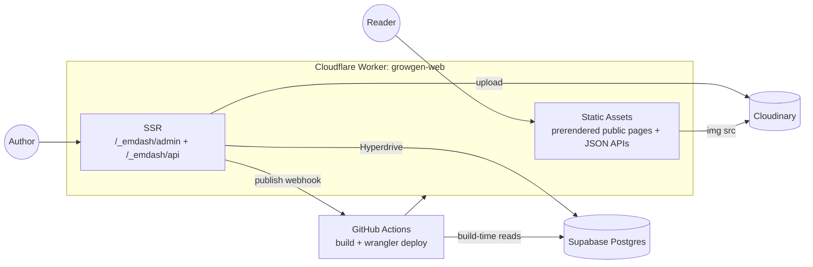
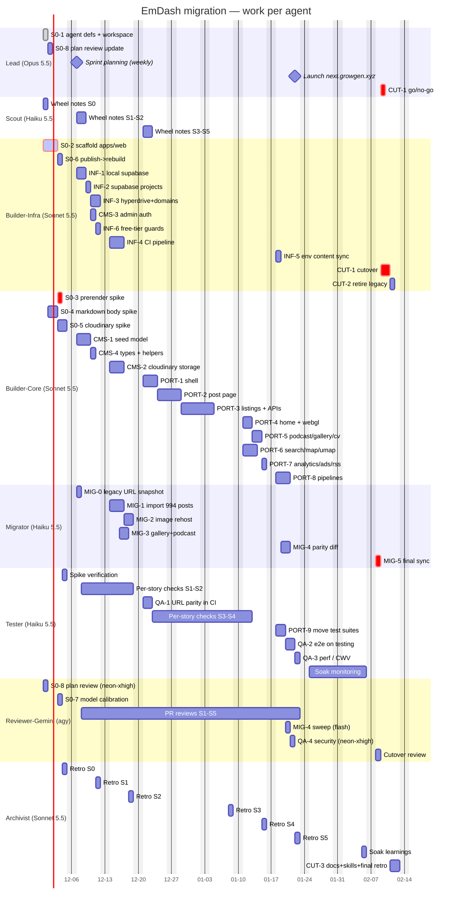

# EmDash Migration Plan

> Status: **DRAFT v2, waiting for owner approval**. No implementation has started.
> Branch: `feat/emdash-migration-plan` · Drafted 2026-11-24 · Orchestrator: Claude Opus 5.5
>
> v2 changes after owner feedback: we build a **fresh EmDash site** (`npm create emdash`) as one workspace package, `apps/web`. It goes live on a **new domain** first and moves to growgen.xyz once stable. **All three environments use Supabase**, local included. The agy (Gemini) models are confirmed from `agy models`.

## 0. Summary

| Concern | Today (legacy site) | Target (new site) |
|---|---|---|
| Codebase | Astro app in repo root `src/` | **Fresh scaffold** from `npm create emdash@latest` (cloudflare template) in **`apps/web`**, a single workspace package |
| CMS / content source | `src/content` git submodule (994 `.md` posts, `_gallery`) | **EmDash 1.x** admin at `/_emdash/admin` |
| Database | none (files) | **Supabase Postgres** in all 3 envs: `local` (`supabase start`), `testing`, `production` |
| Hosting | Vercel (`vercel.json`) | **Cloudflare Worker + Static Assets**: public pages prerendered, admin/API served by the Worker |
| Images | Cloudinary URLs in posts plus Douban and other hot-links | **Cloudinary** for all images, including new uploads |
| Domain | growgen.xyz | New domain (proposed `next.growgen.xyz`) until stable, then **cut over to growgen.xyz** |
| URL paths | `/[category]/[yyyy]/[mm]/[dd]/[slug]` etc. | **Identical paths.** A CI test enforces it. |

**Rule: don't reinvent the wheel.** Each story starts with Scout checking for an EmDash core feature, an `@emdash-cms/*` package, a registry plugin (https://plugins.emdashcms.com), or an npm/Astro integration. We write code only to glue those together.

---

## 1. Feature inventory (what the site does today)

This is the porting checklist: every row maps to a `PORT-*` or `MIG-*` story.

### 1.1 Content and routing
| # | Feature | Legacy location |
|---|---|---|
| F1 | Blog posts with frontmatter `type, category, adsense, tag[], series{slug,name,number}, cover{url,alt}, city[]` | `src/content.config.ts`, `src/content/_docs/YYYY/MM/DD/*.md` (994 files) |
| F2 | Post URL `/[category]/[year]/[month]/[day]/[slug]`. The slug is Astro's glob-loader id (slugified, lowercased file name) | `src/pages/[category]/.../[slug].astro` |
| F3 | Category, tag, series, year, and city listing pages | `[filter].astro`, `tag/`, `tags.astro`, `series/`, `year/`, `world/[city].astro` |
| F4 | Paginated NDJSON/JSON APIs for islands (cards, category, tag, series, year, world, podcast, relates, heatmap, umap, peak) | `src/pages/api/**` |
| F5 | Podcast list and episode pages from a feed | `podcast.astro`, `podcast/[id].astro`, `packages/fetch-podcast` |
| F6 | Gallery with SVG traces and depth estimation | `_gallery`, `packages/prepare-gallery`, `packages/depth-estimation` (Python) |
| F7 | Resume / CV per role and language, plus PDFs generated at build | `resume/[role]/[lang].astro`, `packages/resume` |
| F8 | Static pages: about, contact, privacy, lab, gemini, hero-gallery, sitemap treemap, 404 | `src/pages/*.astro` |
| F9 | RSS feed and XML sitemap with exclusions | `rss.xml.ts`, `@astrojs/sitemap` |

### 1.2 Markdown rendering
| # | Feature | Legacy location |
|---|---|---|
| F10 | KaTeX, `remark-attributes`, external-link rehype, Cloudinary `f_auto,q_auto` rehype | `astro.config.mjs`, `packages/utils/cloudinary.ts` |
| F11 | Shiki with all languages plus PlantUML grammar; Mermaid | `shiki-plantuml`, `astro-mermaid` |
| F12 | MDX components such as `DescriptionImage` (no `.mdx` posts today) | `packages/image` |

### 1.3 Generated data pipelines
| # | Feature | Legacy location |
|---|---|---|
| F13 | Post metadata, covers, colours, `isShort` | `packages/content-prepare`, `packages/image-metadata` |
| F14 | Embeddings (Python) and UMAP (Rust), used by related posts, `/umap`, and the particle hero | `packages/{embedding,metadata-embedding,post-embedding,umap,rag-umap}` |
| F15 | Generated JSON artifacts | `src/content/generated/`, paths in `packages/consts/config.js` |

### 1.4 UI and interactivity
| # | Feature | Legacy location |
|---|---|---|
| F16 | Mantine / MUI / shadcn islands, nanostores state | `src/stores`, `packages/*` |
| F17 | Client search (minisearch + Mantine Spotlight) | `packages/search` |
| F18 | Related posts, carousel, masonry, bento, folders, heatmap, world map (maplibre) | `packages/{carousel,masonry,heat,map,folder}` |
| F19 | WebGL backgrounds, particle hero, Rapier physics (special Vite config) | `src/bits`, `packages/particle-hero` |
| F20 | View transitions, hover prefetch, skeletons | `TransitionFrom.astro`, `stores/skeletons.ts` |
| F21 | View count display (`PV_URL`) | `src/stores/pv.ts` |
| F22 | Newsletter and follow widgets | `NewsLetter.tsx`, `packages/follow` |

### 1.5 Business and operations
| # | Feature | Legacy location |
|---|---|---|
| F23 | Mixpanel with opt-in consent | `packages/analytics` |
| F24 | Google AdSense (per-post flag) | `packages/ads` |
| F25 | Vitest unit tests; Cucumber + Playwright e2e | `vitest.config.ts`, `e2e/` |
| F26 | GitHub Actions: e2e, content submodule sync | `.github/workflows/` |

---

## 2. Target architecture



### 2.1 Repository layout

```
apps/web/            ← NEW: fresh `npm create emdash` scaffold (cloudflare template). One package containing
                       the site, ported islands, stores, styles, seed, wrangler config
packages/            ← legacy UI packages: ported (moved) into apps/web/src during PORT-* stories, deleted at cutover
packages/{content-prepare,fetch-podcast,prepare-gallery,embedding,umap,...}
                     ← data-pipeline tooling stays (different runtimes: Node scripts / Python / Rust);
                       they switch input from the submodule to EmDash (PORT-8)
src/                 ← legacy site, kept running on Vercel/growgen.xyz until cutover, then deleted
supabase/            ← Supabase CLI project (local stack config)
```

Why a fresh scaffold: EmDash upgrades come through the `emdash` package, and our config stays close to the official template, so upgrade notes and docs apply as written. We also leave behind Vercel config, the submodule, and the triple UI-library setup where we can.

### 2.2 Key decisions (each validated by a Sprint 0 spike)

| ID | Decision | Existing wheel we reuse | Risk / fallback |
|---|---|---|---|
| D1 | Scaffold with `npm create emdash@latest -- --template cloudflare` in `apps/web`, then add our integrations (`@astrojs/react`, `@astrojs/mdx`, `@astrojs/rss`, `@astrojs/sitemap`, `astro-mermaid`). The template's D1 and R2 bindings are replaced by Hyperdrive and Cloudinary. | EmDash starter, `@emdash-cms/cloudflare` | Keep a `TEMPLATE_DIFF.md` that records every deviation from the template, so upgrades stay easy. |
| D2 | `output: "server"` with the Cloudflare adapter (from the template). Every public page sets `export const prerender = true` and reads EmDash at build time. Only `/_emdash/*` stays SSR. | Astro prerender, Workers Static Assets | If prerendering against EmDash doesn't work, fall back to SSR plus `cacheCloudflare()` route caching. EmDash purges cache tags on publish. |
| D3 | **Supabase Postgres everywhere.** Runtime: `hyperdrive({ binding: "HYPERDRIVE" })` with caching disabled on the primary binding. Node CLI, migrations and build use `postgres({ connectionString: DATABASE_URL })` with Supabase's **direct or session** connection string. The role must own EmDash tables. | `emdash/db`, Hyperdrive, Supabase CLI | EmDash docs don't name Supabase, but it's standard Postgres. On Postgres there's no core FTS and no sandboxed registry plugins (those are D1-only). We keep our own minisearch and use native npm plugins only. |
| D4 | Environments:<br/>**local**: `supabase start` (Docker, Postgres on `127.0.0.1:54322`). `wrangler dev` / `astro dev` reach it through Hyperdrive's `localConnectionString`.<br/>**testing**: Supabase project `growgen-testing`, `wrangler deploy --env testing` on `*.workers.dev`.<br/>**production**: Supabase project `growgen-production`, production Worker on **`next.growgen.xyz`** now and **growgen.xyz** after cutover. | Supabase CLI, wrangler `env.*`, `npx emdash migrate` | All envs run the same dialect, so nothing drifts between them. Secrets live in `.dev.vars`, wrangler secrets, and GitHub environment secrets. Content moves between envs with EmDash's own `site export` / `site import` (or `export-seed` / `seed`). |
| D5 | Post body stays **Markdown** in a long-text field, rendered at build time by our existing unified pipeline (KaTeX, Mermaid, PlantUML, attributes kept with no loss). | Our pipeline, plus a markdown field from `@emdash-cms/plugin-field-kit` if one exists | Portable Text conversion is backlog item `BL-PT`. |
| D6 | Media on Cloudinary. Preference order: (1) an existing EmDash Cloudinary adapter or provider (registry, npm); (2) a thin adapter implementing EmDash's `Storage` interface over Cloudinary's REST Upload API using signed `fetch` (the Node SDK doesn't run on Workers); (3) the no-code fallback, `s3()` to R2 plus Cloudinary auto-upload mapping. | Cloudinary Upload API, existing `optimizeCloudinaryUrl` | Hot-linked images (Douban and others) are re-hosted to Cloudinary during migration. |
| D7 | Taxonomies `category`, `tag`, `series`, `city` become EmDash taxonomies; series order (`number`) is a post field. | EmDash taxonomies | — |
| D8 | **URL preservation.** Each post stores `legacy_slug` and `published_at` exactly as the legacy build produces them. Astro routes in `apps/web` rebuild the same paths. Every legacy URL is snapshotted from the current build (all HTML and JSON paths plus the sitemap) into `apps/web/tests/legacy-urls.txt`. A CI test fails if the new build is missing any of them. Unavoidable exceptions go into Cloudflare `_redirects`, with a target of zero. | `@astrojs/sitemap`, Cloudflare redirects | Risk: EmDash slug normalisation differs from Astro's. That's why we store `legacy_slug` separately and don't rely on EmDash's own `slug`. |
| D9 | Republishing: EmDash publish fires a webhook, which triggers a GitHub `repository_dispatch`, which builds and runs `wrangler deploy`. We reuse the pattern already in `sync-content.yml` and keep a nightly cron rebuild as a safety net. | existing workflow pattern | A webhook plugin is preferred; otherwise a tiny native plugin using the `content:afterPublish` hook. |
| D10 | Data pipelines (F13–F15) read EmDash (`npx emdash content list --json` or direct SQL read) instead of the submodule, and write the same JSON. | existing pipelines | Option: embeddings in Supabase `pgvector` (`BL-VEC`). |

---

## 3. Agents and their jobs

Agent definitions are created in S0-1 as `.claude/agents/*.md`. Gemini runs through the `cc-suite:agy` skill. Agents update the Gantt chart (§6) when they start (`active`) and finish (`done`) a story.

### 3.1 Roster

| Agent | Model | Role | Owns | Never does |
|---|---|---|---|---|
| **Lead** (orchestrator) | Claude Opus 5.5 (this session) | Architect, sprint planner, final reviewer, contact with the owner | Decision log (§2.2), sprint planning, splitting stories, merge gating | Bulk mechanical edits |
| **Scout** | Claude Haiku 5.5 | Wheel-finder: before each story, searches EmDash docs, the plugin registry, npm and Astro integrations, and writes a "use X / nothing exists" note | `docs/plan/emdash/scout/*.md` | Writing production code |
| **Builder-Core** | Claude Sonnet 5.5 | App work: scaffold, EmDash model and seed, page and API porting, Cloudinary adapter, island porting | `apps/web/src/**`, `apps/web/seed/` | Infra secrets |
| **Builder-Infra** | Claude Sonnet 5.5 | Platform work: Supabase (local and cloud), Hyperdrive, wrangler envs, domains, GitHub Actions, cutover runbook | `apps/web/wrangler.jsonc`, `supabase/`, `.github/workflows/`, `docs/plan/emdash/runbooks/` | Page code |
| **Migrator** | Claude Haiku 5.5 | High-volume mechanical work: legacy URL snapshot, import of 994 posts, image rehosting, old-vs-new HTML diffs | `apps/web/scripts/import/`, migration reports | Design decisions; it escalates anomalies to Lead |
| **Tester** | Claude Haiku 5.5 | Runs vitest, e2e, URL-parity, `emdash doctor`, `emdash migrate --check`; summarises failures | test reports on PRs | Fixing code; it hands failures back to the owning builder |
| **Reviewer-Gemini** | agy, see §3.2 | Independent second opinion: plan review, PR reviews, security review, long-context sweeps | review notes on PRs | Approving its own suggestions |
| **Archivist** (retrospective keeper) | Claude Sonnet 5.5 | After each story, appends "what we learned". At each sprint end, runs the retro (keep / problem / try) and updates `docs/plan/emdash/retro/sprint-N.md` and the running `docs/plan/emdash/knowledge.md` (gotchas, verified commands, rejected options and why). Saves durable lessons to Claude memory | `docs/plan/emdash/retro/`, `knowledge.md`, memory files | Changing code |

**How a story flows:** Lead picks it → Scout writes the wheel note → Builder implements on `emdash/<story-id>` (parallel builders use git worktrees) → Tester runs checks → Reviewer-Gemini reviews → Lead merges into `feat/emdash` → Archivist records lessons → Gantt set to `done`.

### 3.2 agy model assignment (from `agy models`, agy 1.5.16, 2026-11-24)

Available Gemini models: Gemini 4 **Neon / Carbon / Argon / Hydrogen** (Low–High, Neon and Hydrogen also XHigh), three Orchestrator variants, and Gemini 3.8 Flash (Low/Medium/High). agy also exposes Claude Opus/Sonnet 5.5 and GPT-OSS 120B. We don't use agy's Claude models: the point of this agent is a non-Claude second opinion.

| Job | Model (initial) | Why |
|---|---|---|
| Routine PR reviews | `gemini-4-neon-high` (agy default) | Default, high effort |
| Plan review, security review (QA-4), cutover go/no-go | `gemini-4-neon-xhigh` | Most effort, for the riskiest calls |
| Long-context sweeps over large text (994-post HTML diffs, URL lists) | `gemini-3.8-flash-medium` | Cheap and fast for bulk reading |
| Tie-breaker when Claude and Gemini disagree | `gpt-oss-120b-medium` | A third model family |

The agy listing doesn't say how the Neon, Carbon, Argon and Hydrogen families differ. **Story S0-7** runs the same review prompt (a seeded-bug diff from S0-2) through `neon-high`, `carbon-high`, `argon-high` and `hydrogen-high`, compares findings, cost and latency, and updates this table. The Archivist records the result.

---

## 4. Backlog (epics → stories)

Points: 1 = a few hours, 8 = several days.
**Definition of Done:** `pnpm --filter web build` passes · unit tests green · URL-parity green (once QA-1 exists) · e2e `@smoke` green on `testing` · Reviewer-Gemini notes resolved · Gantt updated · Archivist entry written.

### EPIC E0: Foundation and spikes
| ID | Story | Agent | Pts |
|---|---|---|---|
| S0-1 | Agent definitions (`.claude/agents/*.md`), agy review prompt template, `pnpm-workspace.yaml` adds `apps/*` | Lead | 2 |
| S0-2 | **Scaffold** `apps/web` with `npm create emdash@latest -- --template cloudflare`; swap D1 → Hyperdrive and local Supabase; "hello post" deployed to `*.workers.dev`; **measure the Worker bundle against the 3 MB Free limit** (§10); start `TEMPLATE_DIFF.md` | Builder-Infra | 5 |
| S0-3 | **Spike:** prerendered page calling `getEmDashCollection` at build time (D2) | Builder-Core | 3 |
| S0-4 | **Spike:** Markdown body field rendering a KaTeX + Mermaid + PlantUML post (D5) | Builder-Core | 3 |
| S0-5 | **Spike:** Cloudinary media (D6). Scout searches first, then a prototype or the fallback | Scout → Builder-Core | 5 |
| S0-6 | **Spike:** publish → rebuild trigger (D9) | Builder-Infra | 2 |
| S0-7 | agy model calibration (§3.2) | Reviewer-Gemini, Lead | 1 |
| S0-8 | Reviewer-Gemini reviews this plan (`neon-xhigh`); Lead updates decisions | Reviewer-Gemini, Lead | 1 |

### EPIC E1: Environments and infrastructure
| ID | Story | Agent | Pts |
|---|---|---|---|
| INF-1 | **local**: `supabase/` project; `pnpm db:start`, `db:reset`, `emdash migrate`; `pnpm --filter web dev` connects through Hyperdrive `localConnectionString` | Builder-Infra | 3 |
| INF-2 | **testing** and **production** Supabase projects, an EmDash-owner role, and connection strings in GitHub environment secrets | Builder-Infra | 2 |
| INF-3 | Hyperdrive configs per env; `wrangler.jsonc` `env.testing` plus production; custom domain `next.growgen.xyz` | Builder-Infra | 3 |
| INF-4 | CI: PR → migrate `--check`, build, deploy to `testing`, e2e smoke. `master` → migrate, deploy to `production` | Builder-Infra | 5 |
| INF-6 | Free-tier guards: daily keep-alive query to both Supabase projects (prevents pausing); Worker size check in CI (fail above 3 MB); Cloudinary usage report | Builder-Infra | 2 |
| INF-5 | Env content sync: `pnpm content:pull testing` (EmDash `site export/import`) to seed local from testing | Builder-Infra | 2 |

### EPIC E2: CMS model and media
| ID | Story | Agent | Pts |
|---|---|---|---|
| CMS-1 | `seed/seed.json`: `posts` (title, legacy_slug, published_at, status, category, adsense, cover, body markdown, series + number, city), `podcasts`, `gallery`, `pages`, and taxonomies (D7) | Builder-Core | 5 |
| CMS-2 | Cloudinary storage wired in, per the S0-5 outcome | Builder-Core | 5 |
| CMS-3 | Passkey admin login on testing and production; author role | Builder-Infra | 2 |
| CMS-4 | `npx emdash types` in the build; typed data helpers in `apps/web/src/lib/content.ts` (same function signatures as legacy `packages/utils`) | Builder-Core | 2 |

### EPIC E3: Content migration
| ID | Story | Agent | Pts |
|---|---|---|---|
| MIG-0 | **Legacy URL snapshot**: build the legacy site and record every HTML/JSON/XML path plus the sitemap into `apps/web/tests/legacy-urls.txt` | Migrator | 2 |
| MIG-1 | Import the 994 posts through EmDash's CLI/API (no custom DB writes), keeping `legacy_slug` and dates exactly as the legacy build produces them | Migrator | 5 |
| MIG-2 | Rehost non-Cloudinary images to Cloudinary using **`cld migrate`** (an existing CLI command, run with an auto-upload mapping and a URL list), rewrite URLs, report broken links | Migrator | 3 |
| MIG-3 | Import gallery and podcasts; `fetch-podcast` writes into EmDash | Migrator, Builder-Core | 3 |
| MIG-4 | Parity: old vs new rendered HTML diff for all posts; Reviewer-Gemini sweep (`flash-medium`) | Migrator, Reviewer-Gemini | 3 |
| MIG-5 | Idempotent re-import (`--on-conflict update`) for the final sync at cutover | Migrator | 2 |

### EPIC E4: Port features into `apps/web`
| ID | Story | Agent | Pts |
|---|---|---|---|
| PORT-1 | Shell: BaseHead, Global layout, Mantine provider, header, footer, view transitions, prefetch, fonts, Tailwind | Builder-Core | 5 |
| PORT-2 | Post page plus the Markdown pipeline (F2, F10–F12), with identical URLs | Builder-Core | 5 |
| PORT-3 | Listing pages and NDJSON/JSON APIs (F3, F4), with identical URLs | Builder-Core | 8 |
| PORT-4 | Home: hero, carousel, masonry, bento, WebGL/Rapier (F18–F19), including the Vite config from the webgl skill | Builder-Core | 5 |
| PORT-5 | Podcast, gallery, resume + PDFs, static pages (F5–F8) | Builder-Core | 5 |
| PORT-6 | Search, related posts, world map, heatmap, `/umap`, sitemap treemap, view count (F17, F18, F21) | Builder-Core | 5 |
| PORT-7 | Mixpanel + consent, AdSense, newsletter and follow, RSS, sitemap (F9, F22–F24) | Builder-Core | 3 |
| PORT-8 | Data pipelines read EmDash instead of the submodule (D10) | Builder-Core | 5 |
| PORT-9 | Move vitest and e2e suites to target `apps/web` | Tester | 3 |

### EPIC E5: Quality, soak, cutover
| ID | Story | Agent | Pts |
|---|---|---|---|
| QA-1 | URL-parity test in CI against `legacy-urls.txt` (D8) | Tester | 2 |
| QA-2 | e2e on testing, plus admin login and the publish → rebuild path | Tester | 3 |
| QA-3 | Lighthouse / CWV no worse than legacy | Tester | 2 |
| QA-4 | Security review: secrets, admin exposure, Supabase role grants and RLS (`neon-xhigh`) | Reviewer-Gemini | 2 |
| SOAK-1 | Run `next.growgen.xyz` as the live candidate for 2 weeks; owner writes new posts in EmDash; bugs fixed as they come | All | — |
| CUT-1 | Cutover runbook: content freeze → MIG-5 final sync → point growgen.xyz at the Worker → smoke test → rollback (Vercel kept warm for 7 days) | Builder-Infra, Lead | 2 |
| CUT-2 | Retire legacy: delete `src/`, ported `packages/*`, the content submodule, `sync-content.yml`, `vercel.json`; archive the content repo read-only | Builder-Infra | 2 |
| CUT-3 | Update `CLAUDE.md`, `AGENTS.md`, skills (new `emdash` skill); final retro | Archivist | 2 |

### Icebox
`BL-PT` Portable Text bodies · `BL-VEC` pgvector embeddings · `BL-COMMENTS` EmDash comments · `BL-I18N` i18n · `BL-SEARCH` Cloudflare AI Search (needs D1).

---

## 5. Sprints (1 week each)

| Sprint | Dates | Goal | Stories | Pts |
|---|---|---|---|---|
| S0 | 2026-11-30 → 12-04 | Scaffold, prove the risky decisions, agent team ready | S0-1 … S0-8 | 22 |
| S1 | 12-07 → 12-11 | Three Supabase environments, CMS model, URL snapshot, free-tier guards | INF-1…3, INF-6, CMS-1, CMS-3, CMS-4, MIG-0 | 21 |
| S2 | 12-14 → 12-18 | Content in EmDash, images on Cloudinary, CI deploys | CMS-2, MIG-1, MIG-2, MIG-3, INF-4 | 21 |
| S3 | 12-21 → 2027-01-08 (holiday-stretched) | Shell, posts and listings live on testing | PORT-1, PORT-2, PORT-3, QA-1 | 20 |
| S4 | 01-11 → 01-15 | Remaining features ported | PORT-4, PORT-5, PORT-6, PORT-7 | 18 |
| S5 | 01-18 → 01-22 | Pipelines, tests, parity, quality; launch `next.growgen.xyz` | PORT-8, PORT-9, MIG-4, INF-5, QA-2…4 | 20 |
| Soak | 01-25 → 02-05 | Live on new URL, fix as found | SOAK-1 | — |
| S6 | 02-08 → 02-12 | Cut over to growgen.xyz and clean up | MIG-5, CUT-1…3 | 8 |

Ceremonies: **planning** (Lead) at sprint start · **daily** Gantt check (Lead) · **review/demo** for the owner on `testing` at sprint end · **retrospective** (Archivist).

---

## 6. Gantt chart: work per agent

One section per agent. Agents update status with `active` / `done`; Lead marks blockers `crit`.



---

## 7. Top risks

| Risk | Impact | Mitigation |
|---|---|---|
| Prerendering against EmDash at build time isn't a documented path | No static public site | S0-3 tests it on day 3. Fallback: SSR plus Cloudflare route caching |
| EmDash on Postgres is less exercised than D1 (no FTS, no sandboxed plugins) | Missing features | We have our own search; native npm plugins only. S0-2 is the go/no-go |
| EmDash slug rules differ from Astro's slugger | Changed URLs | Store `legacy_slug` (D8) and enforce it with the QA-1 parity test |
| No Cloudinary adapter exists | Extra code | Thin REST adapter, or the R2 + auto-upload fallback |
| Porting WebGL/Rapier into a fresh Vite config | Broken hero | Follow the `webgl-components` skill; port the Vite config first in PORT-4 |
| Worker script over the 3 MB Free limit | Admin can't deploy | Measured in S0-2; fallback is a local-only admin (§10) |
| Supabase Free pauses idle projects | Admin and builds fail | INF-6 daily keep-alive |
| Supabase pooler vs EmDash migrations | Migration failures | Direct or session string for migrations; Hyperdrive for runtime |
| Content written on legacy during the build | Lost posts | MIG-5 idempotent re-import at cutover; freeze legacy writes during soak |

## 8. Access and credentials

Secrets are never pasted into chat or committed. `.env` and `.dev.vars*` are gitignored.

| Service | Status (2026-11-24) | Needed by | Notes |
|---|---|---|---|
| Cloudinary | ✅ `cld` logged in via OAuth, cloud `dmq8ipket` (same cloud as the 2,036 existing post images) | S0-5 | `cld` is at `~/.local/bin/cld`; `cld migrate` is used in MIG-2. The Worker runtime still needs an API key/secret as a wrangler secret, set in CMS-2 |
| Supabase DB passwords | ✅ Generated into repo-root `.env` as `SUPABASE_TESTING_DB_PASSWORD`, `SUPABASE_PRODUCTION_DB_PASSWORD` (32-char alphanumeric, URL-safe) | INF-2 | Used when creating `growgen-testing` / `growgen-production` |
| Cloudflare `wrangler` | ✅ OAuth login, account `2c1ea12e…`; `workers_scripts`, `workers_routes`, `d1`, `zone (read)`; `wrangler hyperdrive list` works | S0-2 | CI uses a scoped API token (Workers Scripts, Hyperdrive, Routes/Custom Domains, Account Settings Read) as a GitHub secret |
| Supabase CLI | ✅ CLI 3.3.0 logged in, org `gongbushang`. One existing project, `map`, is INACTIVE (paused); the free tier allows 2 active projects | S0-2 | |
| Docker | ✅ Docker Desktop 29.8.2 running | S0-2 | Needed for `supabase start` |
| GitHub `gh` | ✅ Logged in as `gongbaodd`, scopes `repo`, `workflow`, `read:org`, `gist` | S0-6 | PRs, environment secrets, `repository_dispatch` |
| agy (Gemini) | ✅ Logged in, agy 1.5.16 | S0-7 | |
| Mixpanel / AdSense | Copy existing values from Vercel env vars | PORT-7 | |

## 9. Owner decisions (2026-11-24)
1. Temporary domain: **`next.growgen.xyz`**. growgen.xyz DNS is already on Cloudflare (`*.ns.cloudflare.com`).
2. Post body: **Markdown field** (D5).
3. **Every service stays on its free plan.** See §10.
4. Sprint 0 has **not started yet**. The owner is still reviewing.

## 10. Free-tier budget (every service on its free plan)

| Service | Free-plan limit | Our expected use | Verdict / guard |
|---|---|---|---|
| **Cloudflare Workers** | 100k requests/day; 10 ms CPU per invocation (DB/network waits don't count); 128 MB memory; 50 subrequests per request; script size **3 MB compressed** on Free (verify in S0-2) | Public pages are **static assets**. Static-asset requests are free and don't invoke the Worker, provided `run_worker_first` stays off. Only the admin and its API run the Worker. | ✅ Requests and CPU OK for one author. ⚠️ **Script size is the main risk**: the EmDash admin bundle plus the Postgres driver may exceed 3 MB. S0-2 measures it with `wrangler deploy --dry-run --outdir`. |
| **Hyperdrive** | Included in Free since 2025-04; 100k queries/day | Admin use only. Builds connect to Postgres directly from GitHub Actions, not through Hyperdrive. | ✅ |
| **Supabase** | 2 active projects; 500 MB DB per project; **paused after 1 week of low activity** | 2 projects (testing, production); `map` stays paused. Posts are a few MB of text in the DB. Images live on Cloudinary, not Supabase Storage. | ✅ Size OK. ⚠️ **Pausing**: a paused production DB breaks the admin and builds. **INF-6** adds a daily GitHub Actions keep-alive query to both projects. The existing nightly rebuild reads the DB too. |
| **Cloudinary** | 25 credits / rolling 30 days (1 credit = 1 GB storage, 1 GB bandwidth, or 1k transformations) | Current usage **4.42 / 25 credits (17.7%)**: 1.29 GB storage, 1.75 GB bandwidth, 1.4k transformations. Rehosting Douban images adds little. | ✅ About 5× headroom. Keep the `f_auto,q_auto` URLs stable so derived images are reused, not regenerated. The Tester checks `cld admin usage` each sprint. |
| **GitHub Actions** | Unlimited minutes for **public** repos | Both repos are public | ✅ Build and deploy run here, not in Workers Builds (whose free plan has a minute cap). |
| **Cloudflare DNS / custom domain** | Free zone plan | `next.growgen.xyz`, then growgen.xyz | ✅ |
| **Mixpanel, AdSense** | Free tiers, unchanged | Same as today | ✅ |

**Features we rule out because they need a paid plan:** EmDash sandboxed registry plugins (need Workers Paid, and D1 rather than Postgres anyway), Cloudflare Images / Stream media providers, Supabase branching / PITR, Workers Logpush.

**Fallback if the Worker exceeds 3 MB (decided in S0-2):** the public site stays 100% static on Workers Static Assets, which needs no script. The EmDash admin then runs **locally** (`pnpm --filter web dev` against production Supabase, using the password in `.env`). Publishing still triggers the GitHub Actions rebuild. This costs nothing; the trade-off is no browser admin away from the laptop.

## Sources
- EmDash docs (database, storage, Cloudflare deployment, CLI, plugins, route caching): https://docs.emdashcms.com
- Cloudflare blog, "EmDash 1.0: the stable CMS with a secure plugin registry", 2026-09-28
- Astro docs, "EmDash & Astro"
- `agy models` output, agy 1.5.16, 2026-11-24
